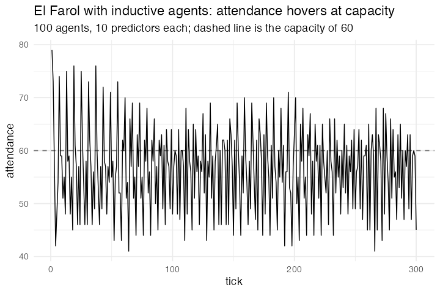

# 14. El Farol with inductive agents (Arthur 1994)

**What was missing.** The short form gives every agent the same forecast, so the
population is one agent chasing its own tail. Heterogeneous *fixed* forecasts do
not help either, the map is still deterministic and still converges. Arthur's
mechanism is inductive: each agent holds several candidate predictors, scores
each one by how well it would have predicted the recent past, and acts on
whichever currently has the smallest error. Nobody's forecast is stable, so the
population's response to a given history keeps changing, and attendance never
settles.

**Package**

Each agent carries a list column of `n_strat` candidate predictors, each a
vector of `memory + 1` random weights (a baseline plus one weight per week of
lag). Three named functions do the arithmetic, following the NetLogo reporters
and procedures they are named after:

```r
# to-report predict-attendance [strategy subhistory]
predict_attendance <- function(strategy, subhistory) {
  100 * strategy[1] + sum(strategy[-1] * subhistory)
}

# how far off would ONE strategy have been, over the last `memory` weeks?
score_strategy <- function(strategy, history, memory) {
  sum(vapply(1:memory, function(week) abs(
    history[week] - predict_attendance(strategy, history[week + 1:memory])),
    numeric(1)))
}

# the strategy that has been least wrong lately (to update-strategies)
best_strategy_of <- function(strategies, history, memory) {
  strategies[[which.min(vapply(strategies, score_strategy, numeric(1),
                               history, memory))]]
}

farol <- function(n_strat = 10, setup_seed = 1, ticks = 300, memory = 5) {
  m <- abm_setup(
    agents = abm_agents(
      n = 100,
      # each strategy is a baseline plus one random weight per week of lag
      strategies = ~replicate(n, replicate(
        n_strat, runif(memory + 1, -1, 1), simplify = FALSE), simplify = FALSE),
      best       = ~lapply(strategies, function(s) s[[1]]),  # replaced at tick 1
      prediction = 0,
      attend     = FALSE),
    globals = list(history = list(sample(0:99, memory * 2, replace = TRUE)),
                   attendance = 0, memory = memory, threshold = 60),
    seed = setup_seed)

  go <- abm_go(
    # update-strategies runs first, so the placeholder never decides anything
    abm_rules(best ~ lapply(strategies, best_strategy_of, history[[1]], memory)),
    abm_rules(prediction ~ vapply(best, predict_attendance, numeric(1),
                                  history[[1]][1:memory])),
    abm_rules(attend ~ prediction <= threshold),
    abm_global(attendance ~ sum(attend),
               history    ~ list(c(attendance, head(history[[1]], -1)))))

  abm_run(m, go, ticks = ticks, record = "globals")
}

result <- farol(n_strat = 10)
```

**Result.** Last 200 of 300 ticks: attendance mean 56.3, sd 7.6, range 41–71, 31
distinct levels, and no exact repeating period, although the correlation at lag 6
is high (+0.92). Attendance hovers around the capacity of 60 and keeps moving
rather than settling, which is Arthur's result.

| predictors per agent | draw 1 | draw 2 | draw 3 | draw 4 |
|---|---|---|---|---|
| 1 | 1 | 1 | 2 | 1 |
| 3 | 6 | 1 | 1 | 4 |
| 10 | 31 | 39 | 51 | 27 |

Distinct attendance levels in the last 200 ticks, over four population draws.
One and three predictors end in a fixed point or an exact cycle (period 10 at
most) in every draw; ten never do.

*Needed nothing new, and the entry it was filed under was wrong.* This model
was first written as seventy scalar columns and five blocks of
`rlang::new_formula()` scaffolding, and cited as proof that an agent could not
hold a set. Model 41 found the list column and this one was rewritten around
it — first onto an exponentially-decayed running error per strategy, which is
not what NetLogo's `update-strategies` actually computes, and now onto the
version above, which re-scores every strategy from scratch each tick against a
fixed `memory`-week backtest, with no memory of any earlier tick's scores. The
two scoring rules give quantitatively different attendance series (the decayed
version has less variance, since it never fully forgets a strategy's older
performance); the version above is the one that matches the source.

*Two simplifications from a literal NetLogo transcription, both checked to cost
nothing.* `best_strategy_of()` scores every strategy independently and takes
`which.min()`, rather than NetLogo's running "keep whichever is currently
lowest" comparison; the two differ only in which strategy wins an exact tie,
and continuous random weights make an exact tie a probability-zero event.
`best`'s placeholder at setup is never backtested against the true starting
history the way NetLogo's `create-turtles` does by calling `update-strategies`
once — instead the update step runs first in `go`, so the placeholder is
corrected before anything ever reads it for a real decision, which is
equivalent by construction and confirmed to reproduce the same output.

**Replication**



**Reproduce:** [`14-el-farol-with-inductive-agents.R`](scripts/14-el-farol-with-inductive-agents.R)

---

← [13. Bank Reserves](13-bank-reserves.md) · [all models](README.md) · [15. Ethnocentrism, Hammond & Axelrod](15-ethnocentrism-hammond-axelrod.md) →
