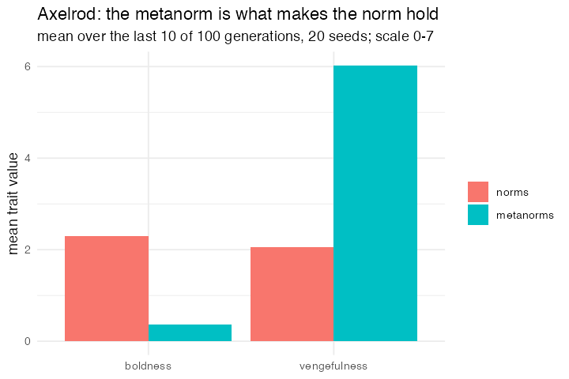

# 30. Norms and metanorms (Axelrod 1986)

**Concept**

- Setup: 20 agents, each with a boldness and a vengefulness on a 0–7 scale
  (Axelrod's 3-bit strings)
- Go, four times per generation: an agent defects if its boldness beats its
  (randomly drawn) chance of being seen; the defector gains `T = 3` and everyone
  else loses `H = 1`; anyone who sees a defection punishes with probability
  proportional to its vengefulness, costing the defector `P = 9` and the
  punisher `E = 2`
- Then a generation turns over: score a standard deviation above the mean and you
  are copied twice, one below and you are not copied at all
- Output: the bare norm **collapses**, punishing is pure cost, so vengefulness
  erodes and boldness climbs. Add a *metanorm*, punishment for seeing a
  defection and letting it go, and the norm holds.

**Package**

```r
mutate3 <- function(x, rate = 0.01) {
  for (b in 0:2) {
    flip <- runif(length(x)) < rate
    x <- bitwXor(x, as.integer(flip) * bitwShiftL(1L, b))
  }
  as.integer(x)
}

opportunity <- function(metanorms) {
  steps <- list(
    abm_rules(seen     ~ runif(n())),
    abm_rules(defected ~ boldness / 7 > seen),
    abm_global(n_def ~ sum(defected)),
    # temptation to the defector, hurt to every other player
    abm_rules(payoff ~ payoff + if_else(defected, T_, 0) +
                        H_ * (n_def - as.integer(defected))),
    # one coin per (observer, observed) pair for noticing, one for acting
    abm_draw(saw ~ runif(n()), zeal ~ runif(n()), .each = "endpoint"),
    # what I saw, and how much of it I chose to punish
    abm_neighbours(witnessed   ~ sum(defected & saw < seen),
                   punish_acts ~ sum(defected & saw < seen &
                                     zeal < own_vengefulness / 7),
                   .default = 0L),
    abm_rules(shirked ~ witnessed - punish_acts,
              payoff  ~ payoff + E_ * punish_acts),
    # how many others punished *me*: the same coins, read from the other end
    abm_neighbours(punishers ~ sum(own_defected & saw_back < own_seen &
                                   zeal_back < vengefulness / 7),
                   .default = 0L),
    abm_rules(payoff ~ payoff + P_ * punishers * as.integer(defected))
  )
  if (!metanorms) return(steps)
  c(steps, list(
    # the metanorm: seeing a defection and letting it go is itself punishable.
    # Fresh coins, and again read from both ends.
    abm_draw(msaw ~ runif(n()), mzeal ~ runif(n()), .each = "endpoint"),
    abm_neighbours(meta_hits ~ sum(own_shirked > 0 & msaw_back < own_seen &
                                   mzeal_back < vengefulness / 7),
                   meta_acts ~ sum(shirked > 0 & msaw < seen &
                                   mzeal < own_vengefulness / 7),
                   .default = 0L),
    abm_rules(payoff ~ payoff + P_ * meta_hits * shirked),
    abm_rules(payoff ~ payoff + E_ * meta_acts)
  ))
}

axelrod <- function(metanorms, n = 20, generations = 100, seed = 1) {
  pop <- abm_setup(
    agents  = abm_agents(n = n,
                         boldness     = ~sample(0:7, n, replace = TRUE),
                         vengefulness = ~sample(0:7, n, replace = TRUE),
                         payoff = 0),
    network = abm_network(type = "complete"),
    globals = list(n_def = 0, mu_p = 0, sd_p = 0,
                   T_ = 3, H_ = -1, P_ = -9, E_ = -2),
    seed    = seed
  )
  go <- abm_go(
    rep(opportunity(metanorms), 4),
    # One generation of selection. Axelrod replicates a player twice if it
    # scored a standard deviation above the mean and not at all if it scored one
    # below; here that is written as a fixed-size resample. The index is drawn
    # *once*, in its own step, so that both traits of a surviving genome travel
    # together.
    abm_global(mu_p ~ mean(payoff), sd_p ~ stats::sd(payoff)),
    abm_rules(offspring ~ case_when(payoff > mu_p + sd_p ~ 2,
                                    payoff < mu_p - sd_p ~ 0,
                                    TRUE                 ~ 1)),
    abm_rules(pick ~ sample(n(), n(), replace = TRUE, prob = offspring + 1e-9)),
    abm_rules(boldness ~ boldness[pick], vengefulness ~ vengefulness[pick]),
    abm_rules(boldness ~ mutate3(boldness), vengefulness ~ mutate3(vengefulness)),
    abm_rules(payoff ~ 0))
  abm_run(pop, go, ticks = generations, seed = seed)
}

result <- axelrod(metanorms = TRUE)
```

**Result.** 100 generations, 20 seeds, averaged over the last ten generations:

| | mean boldness | mean vengefulness | runs where vengefulness collapsed |
|---|---|---|---|
| norms | 2.30 | 2.05 | 7 / 20 |
| metanorms | 0.36 | 6.03 | 0 / 20 |

Axelrod's headline result, both halves of it.

*Forced `abm_network(type = "complete")` and `own_<col>` in `abm_neighbours()`.*
Every agent can see every other, so the population **is** the neighbourhood, but
until now a neighbourhood aggregate could only see the neighbours' columns, and
"how many of the others punished me" needs my own `seen` weighed against each
neighbour's vengefulness. `own_seen` is that. The same addition makes the
commonplace `sum(wealth > own_wealth)`, meaning "how many of my neighbours are
richer than me", expressible for the first time.

*It also forced `abm_draw()`, one round later.* Written the first way, the two
neighbourhood passes (who punished me, and how much punishing I did) drew
independently. Both were correct in distribution, and neither was tied to the
other, so the punishments handed out and the punishments received balanced only
on average: no defector was charged for the acts its own punishers were being
charged for. `abm_draw()` puts the coins on the **edge** instead of inside the
aggregate. Each agent holds one draw per neighbour for whether it noticed that
neighbour and one for whether it acted. The focal agent reads its own as `saw`
and `zeal` and its neighbour's as `saw_back` and `zeal_back`, and because both
ends read the same numbers the two passes are one set of events counted twice.
The test for it is an identity, `sum(punish_acts) == sum(punishers)`, exactly,
every tick, rather than a comparison of means.

*`.each = "endpoint"` came out of writing this model rather than out of the open
item, which asked only for a draw the pair shares. A symmetric draw says* did we
meet*. Whether I noticed you and whether you noticed me are two questions about
one edge, and an asymmetric interaction needs a coin each.*

*The numbers above moved slightly when the draws were tied together, the random
stream is not the same one, but not the result: the bare norm still decays and
the metanorm still holds.*

**Replication**



**Reproduce:** [`30-norms-and-metanorms.R`](scripts/30-norms-and-metanorms.R)

---

← [29. Bounded confidence, all-neighbour](29-bounded-confidence-all-neighbour.md) · [all models](README.md) · [31. Simple Birth Rates](31-simple-birth-rates.md) →
