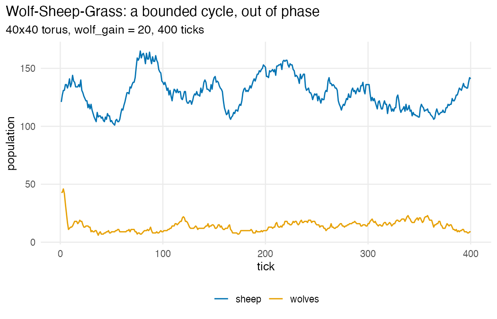
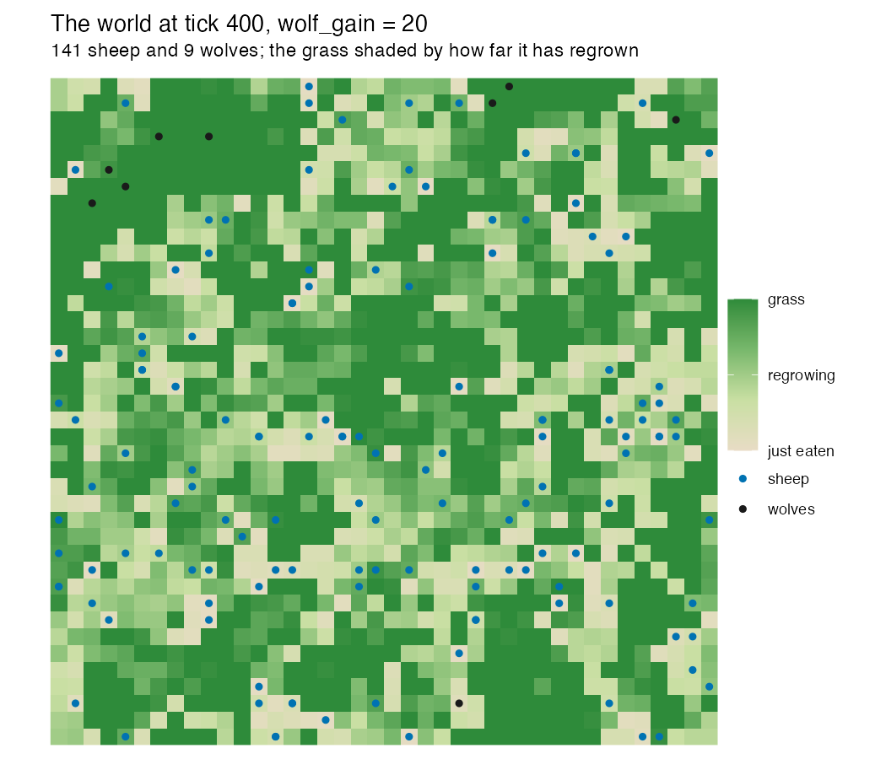
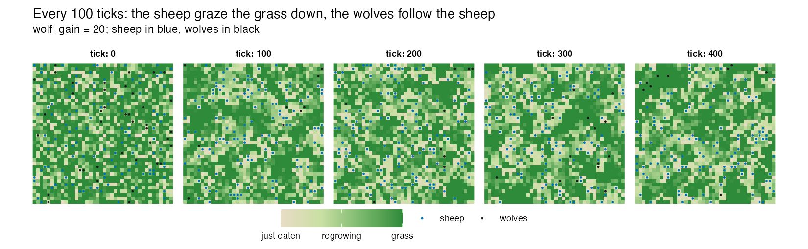

# 5. Wolf–Sheep–Grass (Wolf Sheep Predation, Wilensky 1997)

**Concept**

- Setup: a 40×40 torus of grass patches, 120 sheep and 40 wolves standing on
  them
- Go: everyone steps to a random neighbouring cell and loses energy; sheep eat
  the grass under them, wolves eat a sheep sharing their cell, both reproduce,
  the grass regrows on a timer
- Output: coexistence in a bounded cycle, with the two populations out of phase

**Package**

```r
world <- abm_setup(
  agents = list(
    patches = abm_agents(grass     = ~sample(c(TRUE, FALSE), n, TRUE),
                         countdown = ~sample.int(30, n, TRUE)),
    sheep   = abm_agents(n = 120, energy = ~runif(n, 4, 8)),
    wolves  = abm_agents(n = 40,  energy = ~runif(n, 4, 8))),
  space = abm_space(type = "grid", dims = c(40, 40), on = "patches",
                    diagonals = TRUE, torus = TRUE),
  globals = list(regrow = 30, sheep_gain = 4, wolf_gain = 20,
                 sheep_repro = 0.04, wolf_repro = 0.05),
  seed = 1)

go <- abm_go(
  abm_move(to = "random_neighbour", who = c("sheep", "wolves")),
  abm_rules(energy ~ energy - 1),

  # sheep eat the grass on their cell
  abm_rules(energy ~ energy + sheep_gain, when = .group == "sheep" & cell_grass),
  abm_tell(grass ~ FALSE, countdown ~ regrow, to = .cell,
           when = .group == "sheep" & cell_grass),

  # wolves eat a sheep sharing their cell: one prey per predator, per cell
  abm_match(
    pair = "opposite_group", sides = .group, .by = .cell,
    eligible = .group %in% c("wolves", "sheep"),
    abm_rules(energy ~ energy + wolf_gain, when = .group == "wolves"),
    abm_death(when = .group == "sheep" & !is.na(.partner))
  ),
  abm_death(when = .group %in% c("sheep", "wolves") & energy < 0),

  abm_birth(when = .group == "sheep"  & runif(n()) < sheep_repro,
            cost = energy ~ energy / 2),
  abm_birth(when = .group == "wolves" & runif(n()) < wolf_repro,
            cost = energy ~ energy / 2),

  abm_rules(grass     ~ grass | countdown == 0,
            countdown ~ case_when(grass          ~ countdown,
                                  countdown <= 0 ~ regrow,
                                  TRUE           ~ countdown - 1)),
  abm_global(n_sheep  ~ sum(.group == "sheep"),
             n_wolves ~ sum(.group == "wolves"))
)

result <- abm_run(world, go, ticks = 400, seed = 1, record = "globals")
```

*The model that exercises the whole **L2** spatial grammar at once:
`abm_space(on = "patches")` wires the patch group and gives every mobile agent
`.cell`; `cell_grass` reads the standing patch's `grass` column directly without
a separate `abm_neighbours()` join; `abm_tell(to = .cell)` writes back into that
patch explicitly; a scoped `abm_match(.by = .cell, ...)` pairs wolves and sheep
within each cell and clears the match on exit; and `abm_move()` moves agents
across the grid.*

*The NetLogo original moves continuously (`fd 1` after a random turn); this is
the faithful discrete analogue, which drops the heading.*

**Replication**

`wolf_gain = 10` starves the wolves out and the sheep sit at carrying capacity.
At 20 both persist in a bounded cycle, with the peak cross-correlation at lag
−39 — well away from zero, which is the classic predator–prey signature.

The probe predicted that raising `wolf_gain` further would flip the system to
extinction. It does not: it squeezes it. Minimum sheep fall 101 → 36 → 24 → 2 →
1 as `wolf_gain` goes 20 → 40 → 60 → 100 → 160, with wolves peaking at 320, and
both populations survive 300 ticks even at 160, on the edge of ending.





A patch is either grass or on its 30-tick regrowth timer, and shading the bare
patches by how far along that timer they are shows the grazing as a wake
behind the sheep: the sheep crowd the grass, strip it, and move on, and the
wolves sit where the sheep are.



**Reproduce:** [`05-wolf-sheep.R`](scripts/05-wolf-sheep.R) · **Watch:**
[`05-wolf-sheep.html`](https://rayhanalirachman.github.io/tidyABM/viewers/05-wolf-sheep.html), the standard regime
every other tick, with each animal's energy in the readout (download and open;
see [the viewers](viewers.md))

---

← [4. Schelling, with geography](04-schelling.md) · [all spatial models](README.md) · [6. Ants](06-ants.md) →
