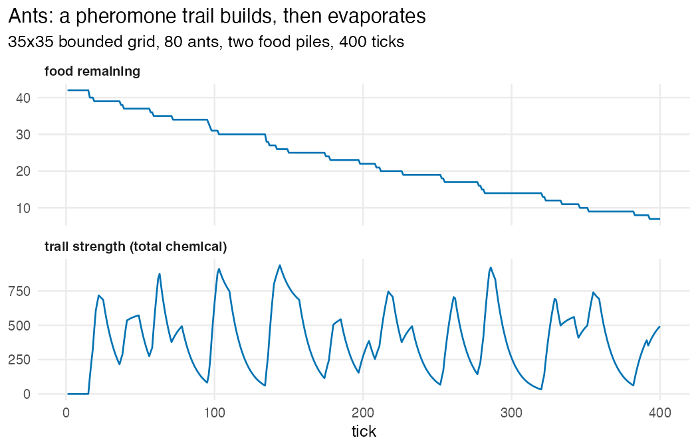
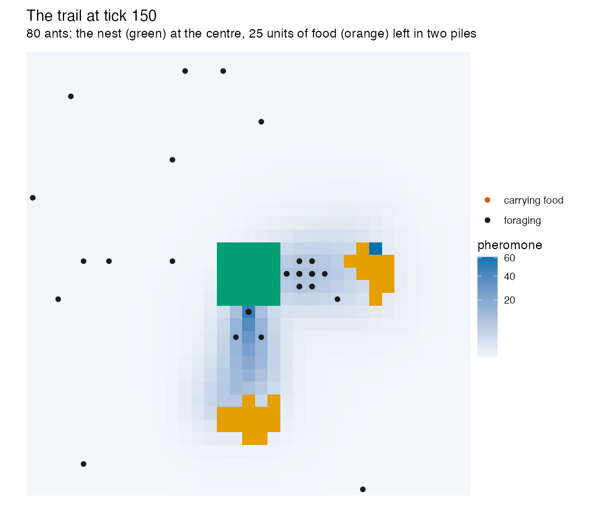
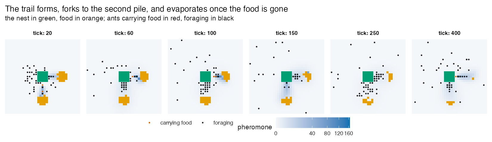

# 6. Ants, pheromone foraging (Ants, NetLogo Models Library, Wilensky 1997)

**Concept**

- Setup: a 35×35 bounded grid with a nest at the centre and two food piles; 80
  ants standing on the nest
- Go: an ant carrying food heads up the nest-scent gradient and drops pheromone
  behind it; an ant not carrying heads up the pheromone gradient; the chemical
  field diffuses and evaporates
- Output: trails form to each pile, the piles are emptied one after the other,
  and the trails evaporate once a pile is spent

**Package**

```r
world <- abm_setup(
  agents = list(
    patches = abm_agents(
      nest       = ~sqrt((.x - cx)^2 + (.y - cy)^2) < 3,
      nest_scent = ~200 - sqrt((.x - cx)^2 + (.y - cy)^2),
      food = ~as.integer(((.x - cx - 9)^2 + (.y - cy)^2 < 7) |
                         ((.x - cx)^2 + (.y - cy + 11)^2 < 7)),
      chemical = 0),
    ants = abm_agents(n = 80, carrying = FALSE, at = ~which(nest)[1])),
  space = abm_space(type = "grid", dims = c(35, 35), on = "patches",
                    diagonals = TRUE, torus = FALSE),
  globals = list(cx = 18, cy = 18, evap = 0.10, diff = 0.30, wiggle = 4))

go <- abm_go(
  # pick up food or drop it at the nest, then decrement food on picked-up cells
  abm_rules(picked   ~ !carrying & cell_food > 0,
            carrying ~ case_when(!carrying & cell_food > 0 ~ TRUE,
                                 carrying & cell_nest      ~ FALSE,
                                 TRUE ~ carrying)),
  abm_tell(food ~ -1L, to = .cell, .resolve = "add",
           when = .group == "ants" & picked),

  # NetLogo `diffuse` + evaporation (using exact per-cell degree `deg` on bounded grid),
  # then this tick's additive pheromone deposits
  abm_neighbours(inflow ~ sum(chemical), deg ~ n()),
  abm_rules(food     ~ pmax(0L, food),
            chemical ~ (1 - evap) * ((1 - diff) * chemical + diff * inflow / deg)),
  abm_tell(chemical ~ 60, to = .cell, .resolve = "add",
           when = .group == "ants" & carrying),

  # head home if carrying, up the trail if not
  abm_move(who = "ants",
           to = uphill(if_else(carrying, nest_scent,
                               chemical + runif(n()) * wiggle))),

  abm_global(food_left  ~ sum(food, na.rm = TRUE),
             carrying_n ~ sum(carrying, na.rm = TRUE),
             chem_total ~ round(sum(chemical, na.rm = TRUE)))
)

result <- abm_run(world, go, ticks = 400, seed = 1, record = "globals")
```

*Everything Wolf–Sheep needs, plus a diffusing and evaporating scalar field on
the patches and gradient-following movement. The diffusion is a documented
two-line idiom over existing steps: `abm_neighbours(inflow ~ sum(chemical), deg ~ n())`
gives exact neighbour counts even on bounded borders, then one `abm_rules()`
applies diffusion and evaporation. Ants read their current patch directly with
`cell_food` and `cell_nest`, and write additive updates directly onto the patch
with `abm_tell(..., to = .cell, .resolve = "add")` (`+=`), eliminating mailbox
columns. `abm_move(to = uphill(...))` is the argmax flavour of movement.*

*Two corrections to the design probe's sketch, and both are the grammar behaving
as documented. `abm_tell()`'s right-hand side is evaluated in the **sender's**
row, so the sketch's `abm_tell(chemical ~ chemical + 60, to = .cell)` reads the
**ant's** `chemical`, which does not exist. An additive deposit wants a per-tick
mailbox column: cleared at the top of the tick, written by every ant on the cell
with `.resolve = "sum"`, then folded into the field. And a pure lattice argmax
traps an ant on a local maximum and it stops finding food — the probe flagged
this as the likely friction, and it is. A small random term inside `uphill()`,
the lattice analogue of NetLogo's `wiggle`, is what makes trails form at all.*

**Replication**

35 of 42 food units taken in 400 ticks. Trail strength peaks at 938 and then
decays as the piles are spent and the deposits stop.





The ants are coloured by whether they are carrying food: a red ant is heading
home up `nest_scent`, a black one is out foraging up the trail. The trail to
whichever pile is being worked is the strong one, and a trail nobody is
walking evaporates within a few dozen ticks.



**Reproduce:** [`06-ants.R`](scripts/06-ants.R) · **Watch:**
[`06-ants.html`](https://rayhanalirachman.github.io/tidyABM/viewers/06-ants.html), the field every other tick with
the nest and food marked (plays in the browser; see [the viewers](viewers.md))

---

← [5. Wolf–Sheep–Grass](05-wolf-sheep.md) · [all spatial models](README.md) · [8. Sugarscape](08-sugarscape.md) →
