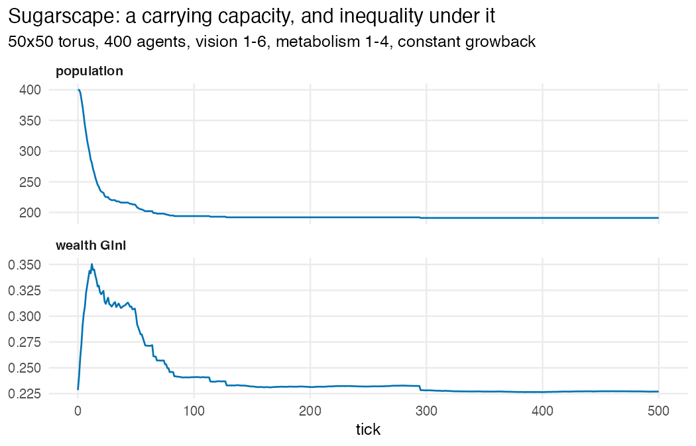
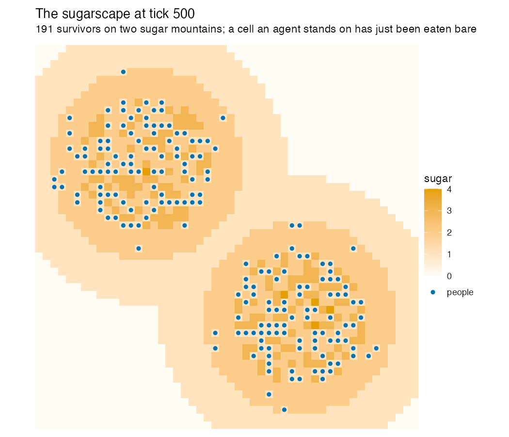
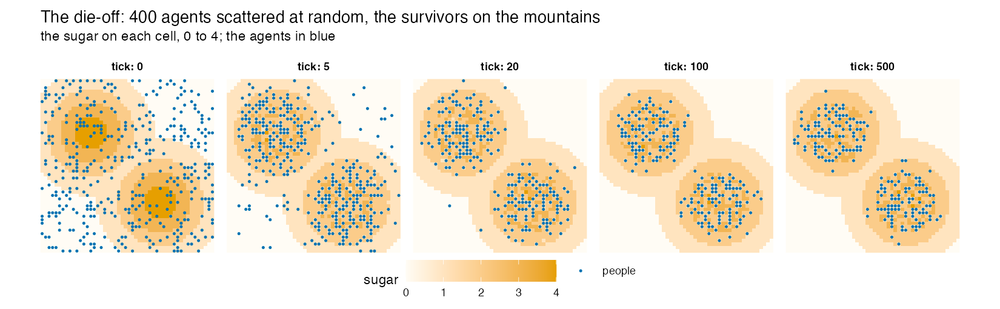

# 8. Sugarscape (Sugarscape 2 Constant Growback, Li & Wilensky 2009, after Epstein & Axtell 1996)

**Concept**

- Setup: a 50×50 torus whose cells hold sugar, terraced up two "mountains" of
  capacity 4; 400 agents on distinct cells, each with a vision (1–6), a
  metabolism (1–4) and a starting endowment (5–25)
- Go: rule **M** — every agent looks `vision` cells along the four axes, moves
  to the richest unoccupied cell it can see, eats all the sugar there and pays
  its metabolism, dying if it runs out; rule **G1** — every cell grows back one
  unit of sugar a tick, up to its capacity
- Output: a carrying capacity, selection for the far-sighted and the frugal,
  and a wealth distribution whose inequality spikes and then settles

**Package**

```r
peak <- function(x, y, px, py) 4 * exp(-((x - px)^2 + (y - py)^2) / (2 * 9^2))

gini <- function(x) {
  x <- sort(x); n <- length(x)
  if (n < 2 || sum(x) == 0) return(NA_real_)
  2 * sum(x * seq_len(n)) / (n * sum(x)) - (n + 1) / n
}

sugarscape <- abm_setup(
  agents = list(
    # two sugar mountains, capacity 4 at the summits, terraced down to 0
    patches = abm_agents(
      capacity = ~as.integer(round(pmax(peak(.x, .y, 15, 35), peak(.x, .y, 35, 15)))),
      sugar    = ~capacity),
    people = abm_agents(n = 400,
                        vision     = ~sample.int(6, n, TRUE),
                        metabolism = ~sample.int(4, n, TRUE),
                        wealth     = ~sample(5:25, n, TRUE),
                        at         = "unique")),                # one per cell
  space = abm_space(type = "grid", dims = c(50, 50), on = "patches",
                    diagonals = FALSE, torus = TRUE),
  globals = list(pop    = ~sum(.group == "people"),
                 wealth = ~mean(wealth[.group == "people"]),
                 gini   = ~gini(wealth[.group == "people"]),
                 vis    = ~mean(vision[.group == "people"]),
                 met    = ~mean(metabolism[.group == "people"])),
  seed = 1)

go <- abm_go(
  # rule M: the richest unoccupied cell within `vision` along the axes
  abm_move(who = "people", to = uphill(sugar),
           range = vision, axes_only = TRUE, avoid_occupied = TRUE),
  # eat what is there, pay the metabolism
  abm_rules(wealth ~ wealth + cell_sugar - metabolism, when = .group == "people"),
  abm_tell(sugar ~ 0L, to = .cell, when = .group == "people"),
  abm_death(when = .group == "people" & wealth <= 0),
  # rule G1: constant growback
  abm_rules(sugar ~ pmin(capacity, sugar + 1L)),
  abm_global(pop    ~ sum(.group == "people"),
             wealth ~ mean(wealth[.group == "people"]),
             gini   ~ gini(wealth[.group == "people"]),
             vis    ~ mean(vision[.group == "people"]),
             met    ~ mean(metabolism[.group == "people"]))
)

result <- abm_run(sugarscape, go, ticks = 500, seed = 1, record = 100)
```

*The **L2+** model that exercises the three extra arguments of `abm_move()`:
`axes_only = TRUE` is the four lines of sight, `avoid_occupied = TRUE` ensures
no two agents share a cell, and per-agent `range = vision` lets each agent look
out to its own sight distance without hand-writing wrap-around arithmetic inside
`uphill()`. The cell the agent stands on is always a candidate, so an agent that
sees nothing better stays put. Eating reads `cell_sugar` directly and clears the
cell with `abm_tell(to = .cell)`.*

**Replication**

From 400 agents the population falls to 191 by tick 300 and holds there to
tick 500: the carrying capacity of two mountains under rule G1. The survivors
are not a random draw from the starters — mean vision rises 3.46 → 3.72 and
mean metabolism falls 2.48 → 1.46, which is Epstein & Axtell's selection
result. Inequality spikes while the poor are dying off (the wealth Gini goes
0.23 → 0.35 by tick 12) and then settles back to 0.23 as wealth accumulates
(mean 15 → 637): once the survivors are the survivors, each one's wealth grows
at a rate set by its vision and metabolism, so the wealth Gini converges on
the Gini of those income rates rather than on the heavier skew Epstein &
Axtell report, whose agents also die of old age and are replaced. And at
every recorded tick no two agents share a cell.





The cells are shaded by the sugar standing on them rather than by their
capacity, so a cell an agent has just left shows as a pale hole in the
mountain that fills back in at one unit a tick.



**Reproduce:** [`08-sugarscape.R`](scripts/08-sugarscape.R) · **Watch:**
[`08-sugarscape.html`](https://rayhanalirachman.github.io/tidyABM/viewers/08-sugarscape.html), every fifth tick,
with each agent's wealth, vision and metabolism in the readout (download and
open; see [the viewers](viewers.md))

---

← [6. Ants](06-ants.md) · [all spatial models](README.md) · [9. Langton's Ant](09-langton.md) →
