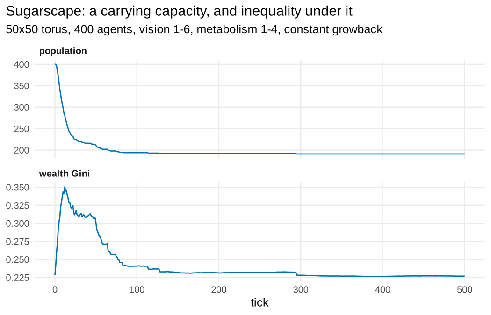
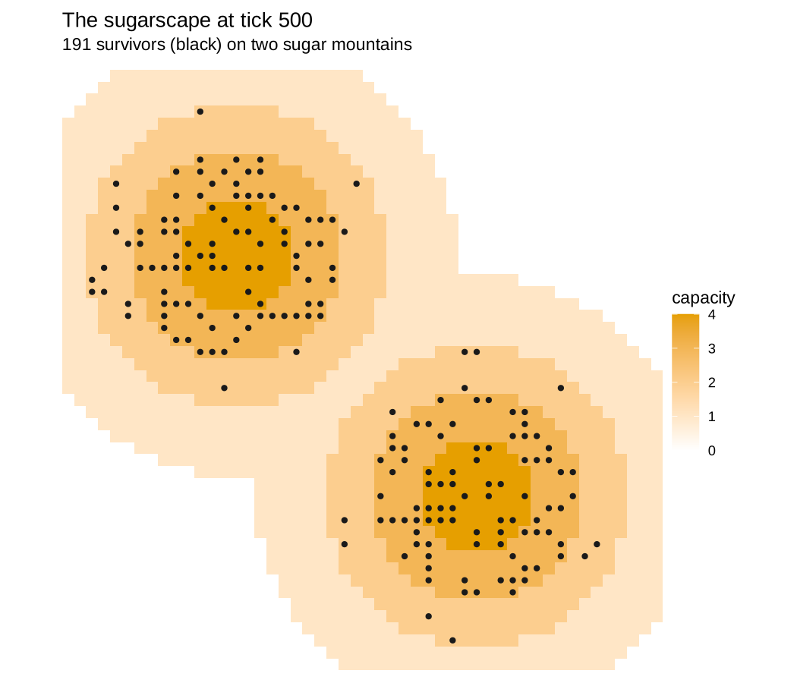

# 8. Sugarscape (Sugarscape 2 Constant Growback, Li & Wilensky 2009, after Epstein & Axtell 1996)

**Concept**

- Setup: a 50×50 torus whose cells hold sugar, terraced up two "mountains" of
  capacity 4; 400 agents on distinct cells, each with a vision (1–6), a
  metabolism (1–4) and a starting endowment (5–25)
- Go: rule **M** — every agent looks `vision` cells along the four axes, moves
  to the richest unoccupied cell it can see, eats all the sugar there and pays
  its metabolism, dying if it runs out; rule **G1** — every cell grows back one
  unit of sugar a tick, up to its capacity
- Output: a carrying capacity, selection for the far-sighted and the frugal,
  and a wealth distribution whose inequality spikes and then settles

**Package**

```r
w <- 50
peak <- function(x, y, px, py) 4 * exp(-((x - px)^2 + (y - py)^2) / (2 * 9^2))

sugarscape <- abm_setup(
  agents = list(
    patches = abm_agents(
      capacity = ~as.integer(round(pmax(peak(.x, .y, 15, 35), peak(.x, .y, 35, 15)))),
      sugar    = ~capacity),
    people = abm_agents(n = 400,
                        vision     = ~sample.int(6, n, TRUE),
                        metabolism = ~sample.int(4, n, TRUE),
                        wealth     = ~sample(5:25, n, TRUE),
                        at         = ~sample(prod(dims), n))),   # one per cell
  network = abm_network(type = "grid", dims = c(w, w), on = "patches",
                        diagonals = FALSE, torus = TRUE),
  seed = 1)

go <- abm_go(
  # rule M: the richest unoccupied cell within `vision` along the axes
  abm_move(along = "patches", who = "people",
           to = uphill(if_else(pmin(abs(.x - own_.x), w - abs(.x - own_.x)) +
                               pmin(abs(.y - own_.y), w - abs(.y - own_.y)) <= vision,
                               sugar, -Inf)),
           range = 6, axes_only = TRUE, avoid_occupied = TRUE),
  # eat what is there, pay the metabolism
  abm_neighbours(here ~ sum(sugar), within = .group == "patches" & .id == own_.cell),
  abm_rules(wealth ~ wealth + here - metabolism, .scope = "population"),
  abm_tell(sugar ~ 0L, to = .cell, when = .group == "people"),
  abm_death(when = .group == "people" & wealth <= 0),
  # rule G1: constant growback
  abm_rules(sugar ~ pmin(capacity, sugar + 1L), .scope = "population"),
  abm_global(pop ~ sum(.group == "people"))
)

result <- abm_run(sugarscape, go, ticks = 500, seed = 1, record = 100)
```

*The **L2+** model that forced the three extra arguments of `abm_move()`, all
at once: `axes_only = TRUE` is the four lines of sight, `avoid_occupied = TRUE`
is the rule that no two agents share a cell, and `range` is how far the lines
run. `range` is one number for the step, so it is the model's longest sight,
and an agent's own `vision` does the rest inside `uphill()`: the expression
sees the candidate cell's `.x` / `.y` and the mover's as `own_.x` / `own_.y`,
and a cell further away than the agent can see scores `-Inf`. The cell the
agent stands on is always a candidate, so an agent that sees nothing better
stays put.*

*One departure from Epstein & Axtell: they break a tie between equally rich
cells towards the nearest, `abm_move()` breaks it at random. Eating is the
co-location join plus a write back into the cell, exactly as sheep eat grass in
[Wolf–Sheep–Grass](05-wolf-sheep.md).*

**Replication**

From 400 agents the population falls to 191 by tick 300 and holds there to
tick 500: the carrying capacity of two mountains under rule G1. The survivors
are not a random draw from the starters — mean vision rises 3.46 → 3.72 and
mean metabolism falls 2.48 → 1.46, which is Epstein & Axtell's selection
result. Inequality spikes while the poor are dying off (the wealth Gini goes
0.23 → 0.35 by tick 12) and then settles back to 0.23 as wealth accumulates
(mean 15 → 637): once the survivors are the survivors, each one's wealth grows
at a rate set by its vision and metabolism, so the wealth Gini converges on
the Gini of those income rates rather than on the heavier skew Epstein &
Axtell report, whose agents also die of old age and are replaced. And at
every recorded tick no two agents share a cell.





**Reproduce:** [`08-sugarscape.R`](scripts/08-sugarscape.R)

---

← [6. Ants](06-ants.md) · [all spatial models](README.md) · [9. Langton's Ant](09-langton.md) →
