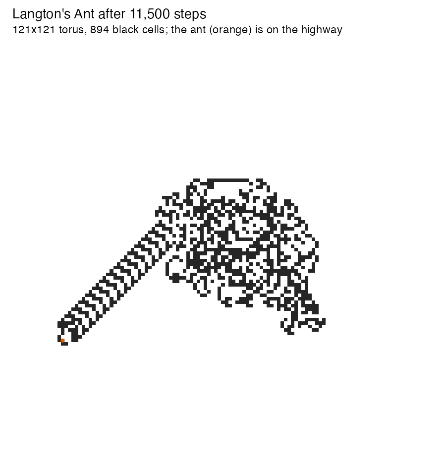

# 9. Langton's Ant (a Turmites variant, NetLogo Models Library)

**Concept**

- Setup: a 121×121 torus of white cells and one ant at the centre facing north
- Go: turn right on a white cell and left on a black one, flip the cell, step
  forward one square
- Output: about ten thousand steps of apparent chaos, and then a period-104
  "highway" that runs off across the lattice forever

**Package**

```r
langton <- abm_setup(
  agents = list(patches = abm_agents(white = TRUE),
                # the centre cell: x = 61, y = 61
                ant     = abm_agents(n = 1, heading = 0L, at = ~61 + 60 * 121)),
  space  = abm_space(type = "grid", dims = c(121, 121), on = "patches",
                     diagonals = FALSE, torus = TRUE))

go <- abm_go(
  abm_rules(heading ~ (heading + if_else(cell_white, 1L, 3L)) %% 4L),
  abm_tell(white ~ !cell_white, to = .cell),
  abm_move(who = "ant", direction = heading)
)

result <- abm_run(langton, go, ticks = 2000, seed = 1, record = "final")
```

*The **L2+** step. Reading the cell is `cell_white`, flipping it is
`abm_tell(white ~ !cell_white, to = .cell)`, and turning is an `abm_rules()` on
`heading`. What this model adds is `abm_move(direction = <column>)` — step one
cell along a stored compass heading.*

**Replication**

The model is deterministic, so this is checked against a plain-R reference
implementation rather than against a summary statistic: cell for cell, plus the
ant's own position and heading, at 100, 500 and 2000 steps. All three match
exactly. The figure runs on to 11,500 steps, past the point (around step
10,000) where the chaotic phase ends and the period-104 highway sets off.



**Reproduce:** [`09-langton.R`](scripts/09-langton.R)

---

← [8. Sugarscape](08-sugarscape.md) · [all spatial models](README.md) · [10. Ising](10-ising.md) →
